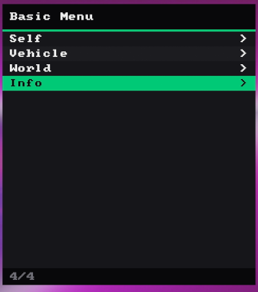

# Basic Menu (src)

Story-mode menu for GTA VI on a jailbroken PS5.

**Released 26 November 2026. Early work in progress: expect bugs.**

## Status

- Tested on **PS5 firmware 7.40 only**. Other firmwares are untested.
- Game version **PPSA38500 01.002.001 only**. Any other version is detected and the menu turns its options off.
- Story mode only. The options lock themselves while the console can reach PSN.
- The menu is very buggy at the moment. Options may not work, may stop working, or may crash the game. Save often.

## Features

| Page      | Options                                                                                   |
|-----------|-------------------------------------------------------------------------------------------|
| Self      | God mode (incl. no fall death), super jump (Square), no-clip fly (hold L3), heal, wanted level, never wanted |
| Vehicle   | Spawn any of 250+ vehicles (in-game names), vehicle god mode, speed boost, vehicle jump, engine on / off, open / close doors and parts |
| Teleport  | Forward / up, save locations and go back to them (works in a vehicle too)                 |
| Locations | 1,100+ named places from the game's place-name table                                      |
| World     | Set hour, freeze time, next weather                                                       |
| Weather   | Any of the 168 weather types                                                              |
| Fun       | Explosions, clone yourself, meteor shower, black hole, explode all vehicles, kill all peds, delete nearby vehicles / peds |
| Money     | Fill stash, fill cash on hand                                                             |
| Items     | Give any item from the game's give table (weapons and more)                               |
| Credits   | Developer, Discord, Ko-fi                                                                 |

## Controls

| Button       | Action                       |
|--------------|------------------------------|
| R3 + Right   | Open menu                    |
| Up / Down    | Move                         |
| Cross        | Select                       |
| Left / Right | Change value                 |
| Circle       | Back / close                 |

## Using it

Nothing here is a ready-to-run package. You need to:

1. Build the menu from `src/` yourself.
2. Load the built `.prx` into the running game with your own loader.
3. Get every tool, SDK and jailbreak component yourself. None are included, linked or listed here.

The menu writes a log to `/data/BasicMenu/menu.log`. Saved locations are kept in `/data/BasicMenu/locations.txt`.

The prebuilt `.prx` in Releases is provided as-is and needs your own loader.

## Source layout

| File                      | What it does                                                        |
|---------------------------|---------------------------------------------------------------------|
| `main.cpp`                | Module entry, startup, main loop                                    |
| `GotHook.*`               | Import-slot hooking                                                 |
| `Input.*`                 | Pad hook, button state, game-thread tick                            |
| `VideoOut.*`              | Display buffer / flip hooks                                         |
| `Overlay.*`               | Draws the menu straight into the display buffer                     |
| `Menu.*`                  | Immediate-mode menu framework                                       |
| `Features.*`              | Menu pages                                                          |
| `Engine.*`                | Game calls: health, wanted, time, spawning, teleport, velocity, item give, version + online checks |
| `Extras.*`                | Names, weather, money, explosions, pools, delete, doors, engine     |
| `Offsets.h`               | Import slots and core addresses for 01.002.001                      |
| `Vehicles.h`, `ItemNames.h`, `Locations.h` | Model, item and place tables                       |
| `Log.*`, `Notify.*`       | File log, system notifications                                      |
| `Font8x8.h`               | Built-in bitmap font                                                |
